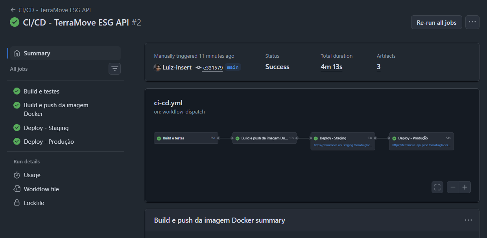
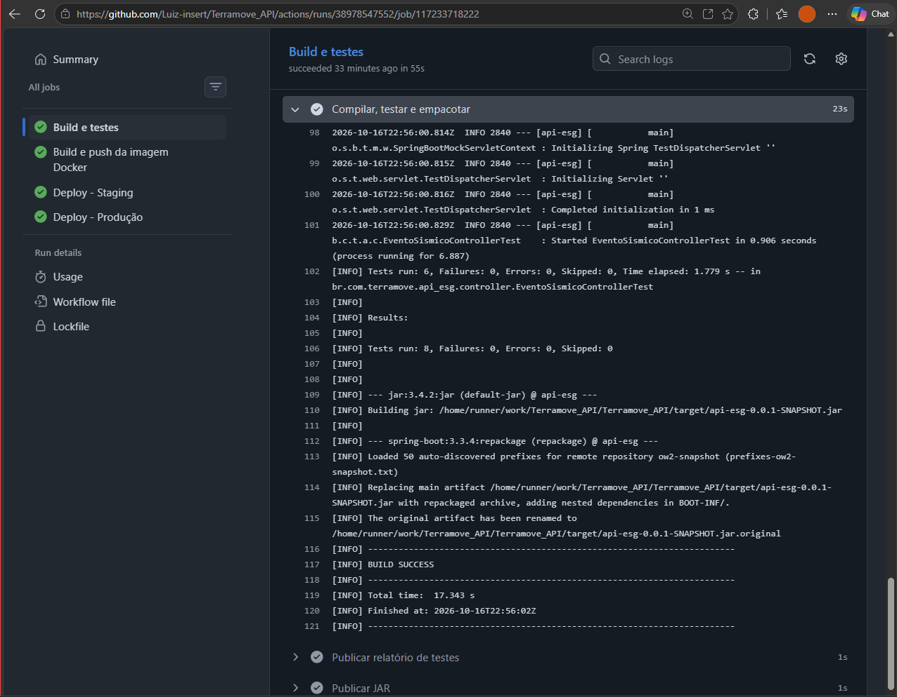
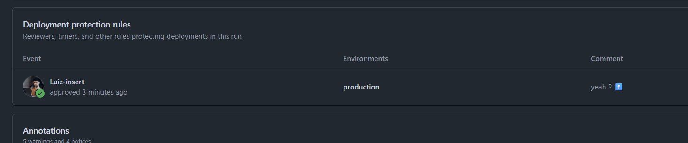
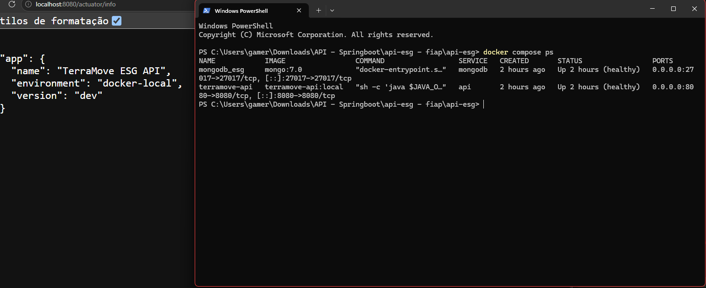
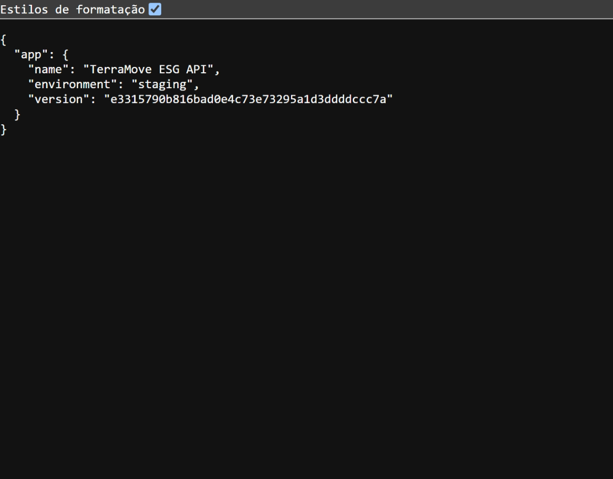
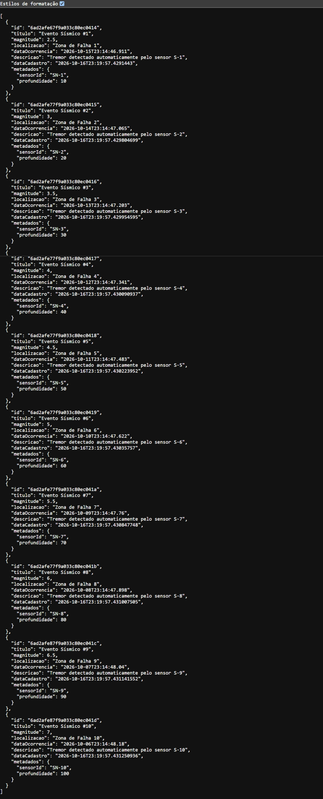
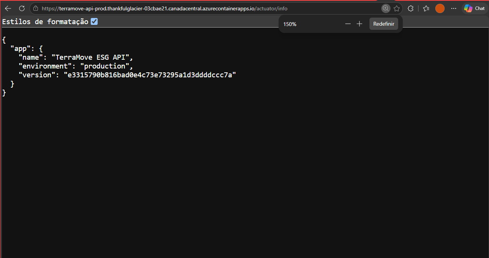
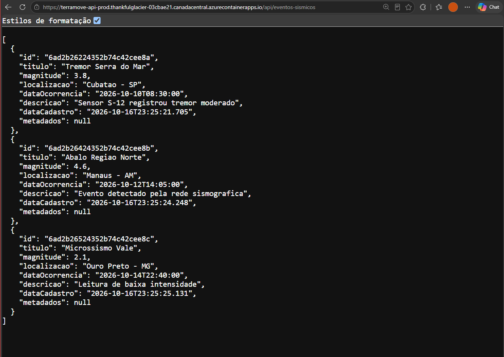

# Projeto - Cidades ESGInteligentes

### TerraMove ESG API — Governança e Compliance Ambiental

API RESTful em **Java 21 + Spring Boot 3.3** com **MongoDB** para monitoramento de regiões, eventos
sísmicos, alertas ambientais e auditorias de compliance (ISO 14001). O ciclo de vida da aplicação é
automatizado com **GitHub Actions**, **Docker** e **Azure Container Apps** (ambientes *staging* e *produção*).

**Integrantes:**

| Nome | RM |
|---|---|
| Ana Carolina Silva Santana | RM565232 |
| Luiz Gusttavo Teixeira Braga | RM561220 |
| Patrick Roth | RM565596 |

---

## Como executar localmente com Docker

**Pré-requisitos:** Docker Desktop em execução e as portas `8080` e `27017` livres.

```bash
# 1. Criar o arquivo de variáveis a partir do exemplo
cp .env.example .env            # no PowerShell: Copy-Item .env.example .env

# 2. Subir MongoDB + API (o build da imagem acontece aqui)
docker compose up -d --build

# 3. Acompanhar os logs da API
docker compose logs -f api

# 4. Testar
curl http://localhost:8080/actuator/health          # {"status":"UP"}
curl http://localhost:8080/api/eventos-sismicos

# 5. Derrubar (adicione -v para apagar também o volume do banco)
docker compose down
```

Na inicialização (fora do perfil `prod`) o `DataLoader` popula o banco com 10 registros de cada coleção.

### Executar sem Docker (desenvolvimento)

```bash
docker run -d -p 27017:27017 --name mongo-dev mongo:7.0   # ou um Mongo local
./mvnw spring-boot:run
./mvnw test                                                # testes
```

### Variáveis de ambiente

| Variável | Descrição | Padrão |
|---|---|---|
| `MONGODB_URI` | Connection string do MongoDB | `mongodb://localhost:27017/esg_db` |
| `SPRING_PROFILES_ACTIVE` | `staging` ou `prod` (vazio = local) | — |
| `APP_SEED_ENABLED` | Limpa e popula o banco ao iniciar | `true` (`false` no perfil `prod`) |
| `APP_ADMIN_PASSWORD` / `APP_USER_PASSWORD` | Senhas dos usuários HTTP Basic | `admin123` / `user123` |
| `APP_VERSION` | Versão exibida em `/actuator/info` (o pipeline usa o SHA do commit) | `dev` |

Veja todos os valores em [`.env.example`](.env.example).

### Endpoints

`GET` é público; `POST`, `PUT` e `DELETE` exigem **HTTP Basic** (`admin`/`admin123` ou `user`/`user123`).

| Recurso | Rota base |
|---|---|
| Regiões monitoradas | `/api/regioes` |
| Eventos sísmicos | `/api/eventos-sismicos` |
| Alertas ambientais | `/api/alertas` |
| Auditorias de compliance | `/api/auditorias` |
| Usuários | `/api/usuarios` |
| Health check / info | `/actuator/health`, `/actuator/info` |

Cada recurso tem `GET /`, `GET /{id}`, `POST /`, `PUT /{id}` e `DELETE /{id}`.
A collection do Postman está em [`ESG-MongoDB-Postman-Collection.json`](ESG-MongoDB-Postman-Collection.json).

---

## Pipeline CI/CD

**Ferramentas:** GitHub Actions (orquestração), GitHub Container Registry (imagens Docker),
Azure Container Apps (hospedagem), MongoDB Atlas (banco de staging e produção).

Arquivo: [`.github/workflows/ci-cd.yml`](.github/workflows/ci-cd.yml)

```
 push na main
      │
      ▼
┌──────────────┐   ┌──────────────────┐   ┌──────────────────┐   ┌───────────────────────┐
│ 1. Build e   │──▶│ 2. Imagem Docker │──▶│ 3. Deploy        │──▶│ 4. Deploy PRODUÇÃO    │
│    testes    │   │   (push GHCR)    │   │    STAGING       │   │  (aprovação manual)   │
│ mvn verify   │   │ tag = SHA commit │   │ + smoke test     │   │  + smoke test         │
│ + MongoDB    │   │ + latest         │   │                  │   │                       │
└──────────────┘   └──────────────────┘   └──────────────────┘   └───────────────────────┘
 Pull requests executam apenas a etapa 1.
```

| Etapa | O que faz |
|---|---|
| **1. Build e testes** | Sobe um MongoDB como *service container*, roda `mvn clean verify` (compilação, testes unitários de controller com MockMvc e teste de integração com MongoDB real) e publica o JAR e o relatório de testes como artefatos. Se algum teste falhar, o pipeline para aqui. |
| **2. Imagem Docker** | Faz o build multi-stage do `Dockerfile` e envia a imagem para `ghcr.io/<usuario>/<repo>` com a tag do commit (`SHA`) e `latest`. Usa cache de camadas do GitHub Actions. |
| **3. Deploy staging** | Faz login no Azure, atualiza o Container App de *staging* com a imagem do commit e executa um *smoke test* em `/actuator/health`. Staging usa o perfil `staging` (banco `esg_staging`, dados de exemplo). |
| **4. Deploy produção** | Só roda depois que staging passou **e** um revisor aprovou (regra de proteção do *environment* `production` no GitHub). Implanta **a mesma imagem** testada em staging, com o perfil `prod` (banco `esg_prod`, sem seed de dados). |

**Configuração necessária no GitHub** (Settings → Secrets and variables → Actions):

| Tipo | Nome | Valor |
|---|---|---|
| Secret | `AZURE_CREDENTIALS` | JSON do service principal (gerado por `infra/azure-setup.sh`) |
| Variable | `AZURE_RESOURCE_GROUP` | ex.: `rg-terramove-esg` |
| Variable | `AZURE_CONTAINERAPP_STAGING` | ex.: `terramove-api-staging` |
| Variable | `AZURE_CONTAINERAPP_PROD` | ex.: `terramove-api-prod` |

E em Settings → Environments: criar `staging` e `production`, e em `production` marcar **Required reviewers**.

### Infraestrutura no Azure

O script [`infra/azure-setup.sh`](infra/azure-setup.sh) provisiona tudo de uma vez (rodar no
[Azure Cloud Shell](https://shell.azure.com)):

```bash
export MONGODB_URI_STAGING="mongodb+srv://<usuario>:<senha>@<cluster>.mongodb.net/esg_staging?retryWrites=true&w=majority"
export MONGODB_URI_PROD="mongodb+srv://<usuario>:<senha>@<cluster>.mongodb.net/esg_prod?retryWrites=true&w=majority"
LOCATION=canadacentral GITHUB_REPO=usuario/repositorio bash infra/azure-setup.sh
```

Ele cria o resource group, o ambiente do Container Apps, os dois Container Apps (staging e produção)
e o service principal, e no final imprime os valores para cadastrar no GitHub. A connection string do
banco fica guardada como **secret** do Container App, nunca no código.

**Banco de dados:** um cluster gratuito (M0) do **MongoDB Atlas**, com um banco para cada ambiente
(`esg_staging` e `esg_prod`). O acesso de rede do Atlas foi liberado para `0.0.0.0/0`, porque o
Container Apps não tem IP de saída fixo; a proteção fica por conta de usuário e senha.
Sem as variáveis `MONGODB_URI_*`, o script tenta criar um Azure Cosmos DB (API MongoDB) no lugar.

> A imagem no GHCR precisa ser **pública** (GitHub → Packages → Package settings → Change visibility)
> ou o script deve ser executado com `GHCR_TOKEN=<PAT com read:packages>`.

---

## Containerização

### Dockerfile

```dockerfile
# Stage 1: Compila o projeto com Maven
FROM maven:3.9-eclipse-temurin-21 AS build
WORKDIR /app
COPY pom.xml .
RUN mvn dependency:go-offline -B
COPY src ./src
RUN mvn clean package -DskipTests -B

# Stage 2: Imagem final só com o JRE
FROM eclipse-temurin:21-jre-alpine
WORKDIR /app
RUN addgroup -S spring && adduser -S spring -G spring
COPY --from=build /app/target/*.jar app.jar
RUN chown spring:spring app.jar
USER spring
ENV JAVA_OPTS="-XX:MaxRAMPercentage=75.0"
EXPOSE 8080
HEALTHCHECK --interval=30s --timeout=5s --start-period=60s --retries=3 \
  CMD wget -qO- http://localhost:8080/actuator/health || exit 1
ENTRYPOINT ["sh", "-c", "java $JAVA_OPTS -jar app.jar"]
```

### Estratégias adotadas

- **Multi-stage build:** o Maven e o JDK ficam só no estágio de build. A imagem final contém apenas o JRE Alpine e o JAR, o que a deixa bem menor.
- **Cache de dependências:** o `pom.xml` é copiado e as dependências baixadas antes do código-fonte. Assim, alterar o código não força baixar tudo de novo.
- **Usuário não-root:** a aplicação roda com o usuário `spring`, sem privilégios de root.
- **Health check:** o Docker verifica `/actuator/health` (Spring Boot Actuator).
- **Memória adaptada ao container:** `MaxRAMPercentage` faz a JVM respeitar o limite de memória do container.
- **Configuração externa:** tudo que muda entre ambientes vem de variáveis de ambiente (12-factor). A mesma imagem roda em local, staging e produção.
- **`.dockerignore`:** exclui `target/`, `.git`, `.env` e documentação do contexto de build.

### docker-compose.yml

Orquestra dois serviços na rede bridge `terramove-network`:

| Serviço | Imagem | Detalhes |
|---|---|---|
| `mongodb` | `mongo:7.0` | Autenticação via variáveis do `.env`, volume nomeado `mongo_data` para persistência, health check com `mongosh` |
| `api` | build do `Dockerfile` | Só inicia quando o MongoDB está saudável (`depends_on: condition: service_healthy`), recebe a URI do banco e as senhas via variáveis de ambiente |

---

## Prints do funcionamento

### Pipeline executando

Execuções: <https://github.com/Luiz-insert/Terramove_API/actions>




### Docker local


### Staging
- URL: <https://terramove-api-staging.thankfulglacier-03cbae21.canadacentral.azurecontainerapps.io/actuator/info>
- API: <https://terramove-api-staging.thankfulglacier-03cbae21.canadacentral.azurecontainerapps.io/api/eventos-sismicos>




### Produção
- URL: <https://terramove-api-prod.thankfulglacier-03cbae21.canadacentral.azurecontainerapps.io/actuator/info>
- API: <https://terramove-api-prod.thankfulglacier-03cbae21.canadacentral.azurecontainerapps.io/api/eventos-sismicos>

> Os ambientes desligam quando ficam sem uso (escala a zero, para economizar créditos).
> O primeiro acesso depois de um tempo parado pode levar cerca de 30 segundos.




---

## Tecnologias utilizadas

| Categoria | Tecnologia |
|---|---|
| Linguagem | Java 21 |
| Framework | Spring Boot 3.3 (Web, Data MongoDB, Security, Validation, Actuator) |
| Banco de dados | MongoDB 7 (local) / MongoDB Atlas (staging e produção) |
| Build | Maven |
| Testes | JUnit 5, MockMvc, Mockito, Spring Security Test |
| Containerização | Docker (multi-stage), Docker Compose |
| CI/CD | GitHub Actions |
| Registry | GitHub Container Registry (GHCR) |
| Cloud | Microsoft Azure (Container Apps, Azure CLI) + MongoDB Atlas |
| Outros | Lombok, Postman |

### Estrutura do projeto

```
api-esg/
├── .github/workflows/ci-cd.yml   # Pipeline CI/CD
├── infra/azure-setup.sh          # Provisionamento da infraestrutura no Azure
├── src/main/java/...             # Código da API (controller, model, repository, security)
├── src/main/resources/
│   ├── application.properties          # Configuração base (variáveis de ambiente)
│   ├── application-staging.properties  # Perfil staging
│   └── application-prod.properties     # Perfil produção
├── src/test/java/...             # Testes unitários e de integração
├── Dockerfile
├── docker-compose.yml
├── .env.example
└── README.md
```

---

## Checklist de entrega

| Item | OK |
|---|---|
| Projeto compactado em .ZIP com estrutura organizada | ☑ |
| Dockerfile funcional | ☑ |
| docker-compose.yml ou arquivos Kubernetes | ☑ |
| Pipeline com etapas de build, teste e deploy | ☑ |
| README.md com instruções e prints | ☑ |
| Documentação técnica com evidências (PDF ou PPT) | ☑ ([docs/Documentacao-Tecnica-TerraMove.pdf](docs/Documentacao-Tecnica-TerraMove.pdf)) |
| Deploy realizado nos ambientes staging e produção | ☑ |
